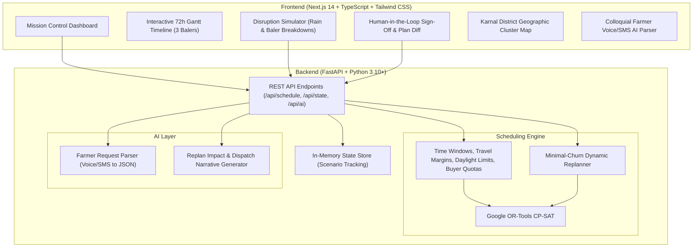

# 🌾 ResidueRelay: Autonomous Paddy Straw Logistics Coordinator

> **A synchronized, AI-assisted harvest logistics platform connecting farmers, machinery operators, and bio-energy buyers to eliminate paddy residue burning in Northern India.**

---

## 🎯 The Problem

In Northern India's rice-wheat cropping system (Punjab & Haryana), farmers have a razor-thin **10 to 15-day window** between harvesting paddy and sowing wheat. Farmers, custom hiring center (CHC) baler operators, and biomass off-takers (Bio-CNG plants, paper mills, biomass thermal power stations) operate with completely disconnected information. Without guaranteed, timely straw clearance, farmers resort to burning residue, creating massive seasonal air pollution across the Indo-Gangetic plain.

**ResidueRelay solves this by creating a single, synchronized harvest plan.**

---

## 🚀 Key Capabilities & Tech Stack



- **Frontend**: Next.js 14, React 18, TypeScript, Tailwind CSS, Lucide Icons.
- **Backend**: FastAPI, Pydantic v2, Uvicorn.
- **Optimization Engine**: **Google OR-Tools CP-SAT** (non-overlapping intervals, daylight operating hours 07:00–19:00, transit buffers, buyer capacities, wheat sowing deadlines).
- **AI Service**: Natural language parser for Hinglish/colloquial farmer SMS and voice transcripts + Plan Diff explainer (dual-mode: Google Gemini API + intelligent offline rule-based parser).
- **Simulated Scope**: Realistic dataset anchored in Karnal District, Haryana (15 farms, 3 balers, 4 buyers).

---

## ⚡ Quickstart (Running the Demo)

### Option A: One-Click Launcher (Windows)
Double-click `start_demo.bat` or run in PowerShell:
```powershell
.\start_demo.ps1
```
This automatically boots:
- **Backend API**: `http://localhost:8000` (Swagger UI at `/docs`)
- **Frontend Dashboard**: `http://localhost:3000`

### Option B: Manual Execution

#### 1. Backend:
```bash
cd backend
python -m pip install -r requirements.txt
python run.py
```

#### 2. Frontend:
```bash
cd frontend
npm install
npm run dev
```

---

## 🏆 3-Minute Hackathon Demo Script

Here is the exact 4-step sequence to demonstrate ResidueRelay to judges:

### Act 1: The Baseline Plan (0:00 - 0:45)
1. Open the dashboard at `http://localhost:3000`.
2. Notice the pre-seeded **15 farms** across Karnal (Taraori, Nilokheri, Indri, and Central clusters), **3 balers**, and **4 industrial buyers**.
3. Point to the **Farmer Intake Ingestion** panel at the bottom: click sample messages to show the AI extracting acreage, village, and deadlines from informal Hinglish text.
4. Click **`1. Generate Plan`**: Watch Google OR-Tools CP-SAT compute an optimal schedule for all 15 farms in ~3 seconds.
5. Review the **Gantt Timeline**: Highlight how Baler 1, 2, and 3 have packed schedules respecting daylight working hours (07:00–19:00) with shaded night bands.
6. Click **`3. Approve Plan`**: Explain that field dispatch orders are not final until a human approves them.

### Act 2: Unseasonal Rain & Mechanical Breakdown (0:45 - 1:30)
1. In the **Mission Control Deck**, click **`⚡ Dual Disruption`** (or click `🌧️ Rain` and `⚠️ Baler 2 Down` individually).
2. Point out immediate visual feedback:
   - Baler #2 shows a bold red **BREAKDOWN - OFFLINE** hazard bar from Hour 10 onward.
   - Affected farms in Taraori spike above safe moisture limits (>26%) and turn **Red / Disrupted**.
   - The Burning Risk gauge spikes as field deadlines are jeopardized.

### Act 3: Dynamic Constraint Replanning (1:30 - 2:15)
1. Click **`2. Re-Optimize`**: OR-Tools solves the degraded state with a *minimal churn penalty*.
2. The UI instantly presents the **Plan Diff Banner (v2)**:
   - Shows which jobs were reassigned from Baler 2 to Baler 1 and Baler 3.
   - Shows rain-affected fields delayed past the 6-hour post-rain drying window without breaching wheat sowing prep deadlines.
   - Read the **AI Dispatch Brief**: Translates the mathematical delta into plain English instructions for baler operators and reassurance messages for farmers.

### Act 4: Human-in-the-Loop Sign-off (2:15 - 3:00)
1. Click **`Approve & Issue Fleet Orders`**:
2. The Gantt timeline transitions into a green approved state.
3. Show the **Cluster Map**: Green route vectors show straw dispatched to Indri Bio-CNG and Panipat Biomass Power Station.
4. Highlight final metrics: **270 Tons of straw cleared**, **0% burning risk**, **~405 Tons of CO₂ prevented**.

---

## 🧪 Automated Test Suite

Run the full backend test suite verifying unit models, distance calculations, CP-SAT constraints, and API endpoints:

```bash
python -m pytest backend/tests -v
```

Run the live HTTP end-to-end smoke test against the running server:
```bash
python backend/tests/test_e2e_live.py
```
